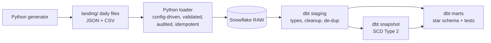
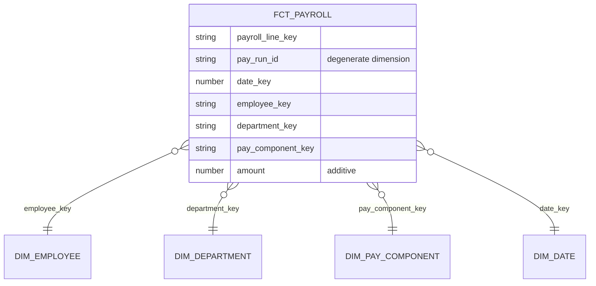

# HR & Payroll Analytics Pipeline

An end-to-end ELT pipeline on **Snowflake** and **dbt**, modelled with **Kimball** dimensional modelling.

Daily HR and payroll extracts land as files (like an SFTP drop from an HR/payroll system). A config-driven Python loader validates and loads them into Snowflake, and dbt turns the raw data into a tested star schema that answers questions like _"what did we spend on pay last month, by department, split into earnings, deductions and employer contributions?"_

The scenario mirrors the HR and payroll integrations I delivered for enterprise clients at Darwinbox, rebuilt on a modern data stack. It's a personal project with generated data, not a production system.

## Architecture



| Layer    | Schema      | Built by      | Purpose                                                     |
| -------- | ----------- | ------------- | ----------------------------------------------------------- |
| Raw      | `RAW`       | Python loader | Data exactly as received, plus lineage columns. Replayable. |
| Staging  | `STAGING`   | dbt (views)   | Cast types, clean values, keep the latest record per key    |
| Snapshot | `SNAPSHOTS` | dbt snapshot  | Full change history of employees (SCD Type 2)               |
| Marts    | `MARTS`     | dbt (tables)  | Star schema for reporting                                   |

## Ingestion: config-driven loader

`loader/sources.yaml` describes every source (file pattern, format, target table, required fields). One generic loader (`loader/loader.py`) applies it, so **adding a new source is a config change, not new code**.

For each new file the loader:

1. **Skips files already loaded**, using the audit table, so re-runs are safe (idempotent)
2. **Reads** JSON or CSV as declared in the config, keeping all values as text (types are cast later in dbt)
3. **Validates** required fields. Bad rows go to `RAW.REJECTS` with a reason instead of failing the load
4. **Loads** good rows into `RAW.<table>` with `_SOURCE_FILE` and `_LOADED_AT` lineage columns
5. **Audits** every file in `RAW.LOAD_AUDIT`: rows read, loaded, rejected, and SUCCESS/FAILED status
6. **Exits non-zero** if any file failed, so a scheduler can alert

Running the loader twice in a row loads nothing the second time.

## Data model

**Business process:** payroll. **Grain of `fct_payroll`:** one row per employee, per pay run, per pay component.



- **`dim_employee`**: built from the snapshot, one row per employee **version**, with `valid_from` / `valid_to` / `is_current`. Department, job title, location and employment status keep their history (SCD2). Name and email always show the current value (SCD1).
- **`dim_department`**, **`dim_pay_component`** (groups components into earnings, deductions and employer contributions), **`dim_date`** (generated calendar).
- **Point-in-time join:** each pay line joins to the employee version valid on the pay date, so pay stays with the department the employee was in when they were paid, even after they move.
- **Surrogate keys** are generated with `dbt_utils.generate_surrogate_key`. The employee key hashes the employee ID and the version start, so every version has its own key.

## Data quality

16 dbt tests run with every `dbt build`:

- `unique` and `not_null` on every surrogate key
- `relationships` from every fact key to its dimension (no orphaned rows)
- `accepted_values` on pay components
- A reconciliation test: total pay in `fct_payroll` must equal total pay loaded into RAW

## Running it

Requires Python 3.12 and a Snowflake account.

```bash
python3.12 -m venv .venv && source .venv/bin/activate
pip install -r requirements.txt
```

Create a `.env` file (never committed) with `SNOWFLAKE_ACCOUNT`, `SNOWFLAKE_USER`, `SNOWFLAKE_PASSWORD`, `SNOWFLAKE_ROLE`, `SNOWFLAKE_WAREHOUSE`, `SNOWFLAKE_DATABASE`, and set up a dbt profile with `dbt init`.

```bash
python generator/generate.py      # create two days of extracts in landing/
python loader/loader.py           # load new files into Snowflake RAW
cd hr_dw
dbt deps
dbt snapshot                      # capture employee history (run after each load)
dbt build                         # build all models and run all tests
```

Snowflake costs are controlled with an X-Small warehouse, 60-second auto-suspend, and a resource monitor that suspends the warehouse at a credit quota.

## What I'd do next

- Switch the snapshot to the `check` strategy on only the SCD2 columns, so an email correction doesn't create a new version
- Make `fct_payroll` incremental instead of rebuilding it each run
- Add a monthly headcount fact (periodic snapshot, semi-additive)
- Orchestrate load, snapshot and build on a schedule (Airflow or dbt Cloud), and run `dbt build` in CI on every pull request
- Use key-pair authentication and a secrets manager instead of a password in `.env`
- Manage Snowflake objects (warehouse, roles, schemas) with Terraform
